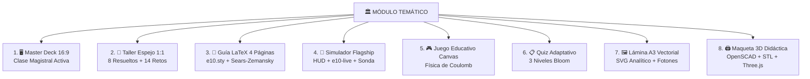
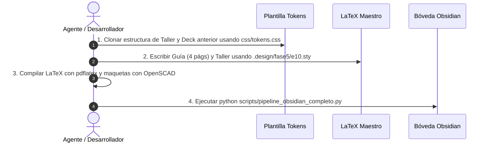

# 🧠 Manual Maestro de Arquitectura, Patrones de Diseño y Reutilización
## Ecosistema Educativo Digital · Electro10.Easy

> **Propósito de esta Guía:**  
> Servir como la **fuente de verdad técnica y pedagógica** para entender **qué se hace, cómo se hace, cuáles son los patrones arquitectónicos y cómo replicar o reusar** cada pieza del ecosistema en cualquier módulo nuevo (M01 a M13).  
> Ningún modelo de IA ni desarrollador humano debe programar a ciegas: todos los componentes deben heredar estos patrones probados.

---

## 🏛️ 1. La Anatomía Canónica del Módulo: Los 8 Entregables

Cada uno de los 13 módulos temáticos de Electromagnetismo contiene exactamente **8 componentes canónicos**, diseñados para cubrir las fases de aprendizaje según la Taxonomía de Bloom:



---

## 🎨 2. Sistema de Diseño Unificado: Paleta «Plasma» y Tipografía

### 2.1 Variables CSS Canónicas (`css/tokens.css`)
No se utilizan estilos ad-hoc, ni Tailwind CDN, ni colores inventados. Todas las interfaces web consumen:

```css
:root {
    /* ── Marca Plasma ── */
    --e10-primary: #b3246b;          /* Magenta de plasma: botones, acentos, marca */
    --e10-primary-hover: #8f1b55;
    --e10-primary-soft: #f8e6ef;     /* Fondos suaves: paneles de fórmula, chips */
    --e10-accent: #0b8ca8;           /* Cian osciloscopio: gráficos, vectores */
    --e10-accent-strong: #08758c;    /* Cian para texto legible (WCAG ≥ 5:1) */
    --e10-accent-soft: #e3f4f8;      /* Fondos de recomendaciones y consejos */

    /* ── Neutros Técnicos ── */
    --e10-bg: #fbf8fa;               /* Fondo cálido de la plataforma */
    --e10-surface: #ffffff;          /* Tarjetas y ventanas modales */
    --e10-surface-2: #fdfbfc;        /* Lienzo de simulación técnica */
    --e10-line: #ecdde6;             /* Divisores y bordes finos */
    --e10-ink: #22111b;              /* Texto principal de alto contraste (17:1) */
    --e10-muted: #6a5562;            /* Texto secundario y metadatos */

    /* ── Jerarquía Tipográfica ── */
    --e10-font-display: 'Sora', 'Segoe UI', system-ui, sans-serif;
    --e10-font-body: 'IBM Plex Sans', 'Segoe UI', system-ui, sans-serif;
    --e10-font-mono: 'IBM Plex Mono', 'Cascadia Code', Consolas, monospace;
    --e10-font-serif: 'IBM Plex Serif', 'Georgia', serif;
}
```

### 2.2 Paquete de Impresión LaTeX (`.design/fase5/e10.sty`)
Los documentos imprimibles (PDFs) reflejan con exactitud micrométrica los mismos colores y fuentes:
* **Fuentes:** `plex-sans` (títulos y etiquetas), `plex-serif` (cuerpo de lectura prolongada), `plex-mono` (código Python y URLs), `newtxmath` (símbolos matemáticos).
* **Cajas Semánticas `tcolorbox`:** `eResuelto` (magenta suave), `eReto` (cian suave), `eClave` (magenta), `eError` (amarillo cálido), `eConsejo` (cian), `eFormula` (centrado).
* **Portada:** `\ePortada{Capítulo}{Tipo}{Título}{Subtítulo}` con banner magenta superior de 7 mm y supresión de guiones en títulos (`\hyphenpenalty=10000`).

---

## 📐 3. Patrón 1: Taller Interactivo Espejo 1:1 (`Taller_N.html` ↔ `CapN_Taller.pdf`)

### ¿Qué se hace?
Un cuaderno de trabajo estructurado en **8 problemas resueltos exhaustivos** y **14 retos graduados**.

### Reglas de Arquitectura:
1. **Doble Vía de Solución Obligatoria:**
   - **Camino A (Formal / Integral):** Cálculo infinitesimal, integrales de línea, argumentos de simetría y vectores unitarios.
   - **Camino B (Directo / Balance Energético):** Fórmulas cerradas, teoremas de conservación del trabajo y energía o métodos operacionales.
2. **Caja Predictiva Previa (`.pred` / `ePredice`):**
   - Antes de mostrar los números, se desafía al estudiante a predecir el comportamiento cualitativo (¿aumenta?, ¿se anula?, ¿hacia dónde apunta?).
3. **14 Retos con Validador Numérico Tolerante (`window.__tallerN`):**
   - El estudiante escribe su resultado numérico en notación científica o decimal.
   - El motor acepta respuestas dentro de un margen de tolerancia física del $\pm 2\%$.
   - Guarda el progreso en `localStorage` con feedback visual inmediato (verde éxito, rojo reintentar con pista).

---

## 🖥️ 4. Patrón 2: Master Deck 16:9 (`presentaciones/MN_*/index.html`)

### ¿Qué se hace?
Una presentación web diseñada para dictado interactivo en pantalla gigante o proyector.

### Reglas de Arquitectura:
1. **14 Diapositivas Exactas (`.slide`):** Relación de aspecto panorámica 16:9 (`data-n="14"`).
2. **Componente Stepper `.stp` de 7 Pasos:**
   - Cada demostración analítica se divide en 7 pasos didácticos.
   - Tipografía con tamaño mínimo $\ge 18\text{px}$.
   - Solo un paso activo visible a la vez para no sobrecargar cognitivamente al estudiante.
   - **Regla Crítica:** Ningún elemento puede desbordar o solaparse con el pie de diapositiva (`.foot`).
3. **KaTeX Display 0.16.9:**
   - Renderizado matemático puro con KaTeX local/CDN sin librerías externas pesadas.
4. **Recursos de Cierre:**
   - Diapositiva de Árbol de Decisión de Simetrías.
   - Mapa Mental Conceptual SVG.
   - Línea de Tiempo Histórica y Glosario 3D con efecto `.flip`.

---

## 🧪 5. Patrón 3: Simulador Flagship Lab10.easy (`simuladores/*Lab.html`)

### ¿Qué se hace?
Un laboratorio virtual en HTML5 Canvas / WebGL de ultra-alta fidelidad física.

### Reglas de Arquitectura:
1. **Cascarón HUD Glassmorphism:**
   - Barra superior translúcida con selector de las 4 escenas canónicas del módulo.
   - Gaveta colapsable `#values` para configurar parámetros físicos ($q$, $d$, $\lambda$, $\sigma$, $R$).
2. **Barra Flotante KaTeX en Vivo (`#e10-live`):**
   - Mientras el estudiante arrastra cargas o mueve sliders, la barra muestra la ecuación en tiempo real sustituyendo las variables por sus valores numéricos instantáneos.
3. **Sonda Voltímetro / Magnetómetro Interactiva:**
   - Instrumento virtual arrastrable por el lienzo que mide el potencial o campo en $(x,y)$ y dibuja el vector $\vec{E}$ o $\vec{B}$ ortogonal en la punta.
4. **Telemetría de Errores Pedagógicos (`_sendSimTelemetry`):**
   - Monitorea errores comunes identificados en el Sears-Zemansky (e.g., olvidar que el campo es ortogonal, sumar magnitudes en vez de vectores, confundir $r$ con $r^2$).
   - Comunica los eventos a `js/seguimiento.js`.

---

## 🖼️ 6. Patrón 4: Lámina / Póster A3 Vectorial (`laminas/MN_*.html`)

### ¿Qué se hace?
Una infografía técnica panorámica de nivel póster universitario ($1600 \times 1131\text{ px}$).

### Reglas de Arquitectura:
1. **Gráficos 100% Vectoriales (SVG Puro):**
   - Cero loops de píxeles rasterizados `4x4`.
   - Curvas de nivel analíticas y líneas de flujo suaves usando `path d="M... C..."`.
2. **Pulsos Fotónicos Animados (`.ph`):**
   - Animación continua de micro-partículas de luz a lo largo de las líneas de campo mediante `stroke-dasharray` y `@keyframes pulse`.
3. **Organización en 9 Bloques Técnicos:**
   - Portada y Metadatos, Principio Fundamental, 4 Configuraciones Analíticas, Escala Numérica de Magnitudes, Errores Frecuentes, y Línea de Tiempo.

---

## 🖨️ 7. Patrón 5: Maqueta Didáctica 3D Tangible (`recursos/modelos_3d/`)

### ¿Qué se hace?
Una pieza tangible para fabricación digital FDM (impresoras 3D).

### Reglas de Arquitectura:
1. **Script Paramétrico `.scad` (OpenSCAD):**
   - Variables de dimensión configurables, tolerancias de encaje ($0{,}3\text{ mm}$), facetas suaves (`$fn=60`).
2. **Compilación Binaria Real (`.stl`):**
   - Compilado automáticamente mediante la CLI: `openscad -o modelo.stl modelo.scad`.
   - Tamaño típico: entre $1\text{ MB}$ y $15\text{ MB}$.
3. **Ficha Técnica Interactiva (`.html`):**
   - Visualizador 3D en navegador con Three.js que permite rotar, acercar y examinar la pieza antes de imprimir.

---

## 📋 8. Matriz de Reutilización: Cómo Crear un Nuevo Módulo en 4 Pasos

Para construir el siguiente módulo (e.g., M05 Ley de Gauss o M06 Capacitancia), siga estrictamente este orden:



1. **Paso 1: Estructura Web:** Clonar el archivo de presentación y taller anterior, renombrar identificadores (`__c5`, `__taller5`, `m5_*`), importar `css/tokens.css` y KaTeX 0.16.9.
2. **Paso 2: Código LaTeX Oficial:** Copiar el paquete `.design/fase5/e10.sty`. Redactar la Guía asegurando exactamente 4 páginas y el Taller con los 8 problemas resueltos y 14 retos.
3. **Paso 3: Compilación Local:** Ejecutar `pdflatex -interaction=nonstopmode` para generar los PDFs en `recursos/` y compilar la pieza `.scad` a `.stl`.
4. **Paso 4: Ingestión Automática a Obsidian:** Ejecutar `python scripts/pipeline_obsidian_completo.py` para regenerar notas atómicas, matrices de enlaces y vistas previas de imágenes.
