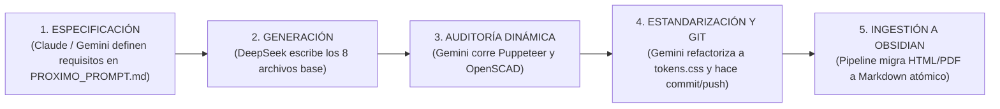

# 🤖 Protocolo Tripartito de Sincronización y Memoria Multi-Agente
## Orquestación: DeepSeek · Gemini (Antigravity) · Opus (Claude Code)

> **Propósito Central:** Evitar la amnesia, la duplicidad y las desviaciones de código entre los tres modelos de Inteligencia Artificial que operan en este proyecto. Todo agente debe **leer este archivo antes de ejecutar cualquier comando** y **actualizar el cuaderno de relevo al terminar**.

---

## 🏛️ 1. Matriz de Roles y División del Trabajo

| Agente | Modelo / Entorno | Fortaleza Clave | Responsabilidad Primaria en el Proyecto | Lo que NUNCA debe hacer |
| :--- | :--- | :--- | :--- | :--- |
| **DeepSeek** | DeepSeek-V3 / R1 (CLI / Web / API) | Generación veloz de código masivo y lógica procedural. | **Generador de Borrador Inicial de Módulos:** • Lee `PROXIMO_PROMPT.md` • Escribe el primer borrador de los 8 componentes canónicos (Taller, Deck, Simulador, Póster, Juego, Quiz, Desafío, 3D SCAD). | ❌ **PROHIBIDO:** • Inyectar Tailwind CDN (`cdn.tailwindcss.com`). • Usar librerías externas de PDF (`html2pdf`). • Inventar pizarras `<canvas>` flotantes. • Mencionar a la UNAB. • Usar loops de píxeles $4\times 4$ en SVG. • **Crear archivos `e10.sty` ad-hoc, mutilados o alternativos en LaTeX**. Todo documento `.tex` debe compilar usando única y exclusivamente el paquete canónico `.design/fase5/e10.sty` (IBM Plex, Plasma Palette, `tcolorbox`, `\ePortada`, TikZ vectorial y Sears-Zemansky). |
| **Gemini (Antigravity IDE)** | Gemini 2.5 Flash / Pro (Entorno AGY) | Automatización nativa, compilación de hardware, testing en navegador y gestión de herramientas locales. | **Arquitecto de Calidad, Compilador y Validador en Tiempo Real:** • Compila maquetas OpenSCAD a STL binario con la CLI local. • Ejecuta validaciones dinámicas con **Puppeteer headless** en navegador real. • Compila documentos LaTeX con `pdflatex` verificando 4 páginas exactas para Guías y los 8 problemas + 14 retos para Talleres. • Audita macros de diseño (`\ePortada`, `eResuelto`, `eReto`, `eClave`, `eError`, `eConsejo`). • Ejecuta la suite estática `node scripts/prueba_cap*.cjs`. • Ejecuta el pipeline de ingestión masiva a Markdown en Obsidian (`scripts/pipeline_obsidian_completo.py`). • Gestiona Git commits y sincronización con GitHub. | ❌ **PROHIBIDO:** • Dejar archivos a medias sin commit ni push. • Modificar lógica física sin verificar Sears-Zemansky. • Romper compatibilidad con `css/tokens.css`. • Permitir PDFs generados con estilos visuales degradados o comandos planos de LaTeX. |
| **Opus (Claude Code)** | Claude 3.7 Sonnet / Opus (Terminal CLI) | Razonamiento físico profundo, deducción simbólica y memoria contextual persistente. | **Especialista en Rigor Académico y Memoria Persistente:** • Audita las soluciones analíticas de los talleres (Cálculo integral vs Trabajo-Energía). • Diseñador del paquete tipográfico maestro `e10.sty` (IBM Plex + tcolorbox + Plasma). • Verifica la coherencia de fórmulas KaTeX 0.16.9. • Actualiza la bitácora histórica (`CLAUDE.md`, `napkin.md`, `claude-mem-obsidian`). • Diseña rúbricas pedagógicas según la Taxonomía de Bloom. | ❌ **PROHIBIDO:** • Modificar estilos visuales sin respetar el estándar Plasma Glassmorphism. • Quemar tokens leyendo PDFs binarios (debe leer siempre el Markdown en `Vault_Electro10_Easy/08_Guias_y_PDFs/`). |

---

## 🔄 2. Máquina de Estados de Relevo (Handover Workflow)

Cada módulo (M1 a M13) avanza estrictamente por 5 estados secuenciales:

---

## 📋 3. Protocolo Pre-Flight Obligatorio (Antes de Iniciar Turno)

Cualquier agente que tome el control debe seguir este protocolo en 3 pasos:
1. **Comprobar Estado Activo:**
   - Leer este archivo: `ESTADO_GLOBAL_AGENTES.md`.
   - Verificar rama Git: `git status` (debe estar limpio en `main`).
2. **Revisar Restricciones Activas:**
   - 100% Vanilla CSS con tokens desde `css/tokens.css` (`var(--e10-*)`).
   - Cero menciones de UNAB (Solo **10.Easy / Electro10.Easy** y Prof. Dudbil Olvasada Pabón Riaño).
   - Sears-Zemansky Vol. 2 como fuente exclusiva de física.
3. **Consumir Fuentes en Markdown:**
   - Si se necesita consultar un taller, parcial o libro, **NO leer PDFs binarios**.
   - Leer directamente la transcripción atómica en `Vault_Electro10_Easy/`.

---

## 📓 4. Cuaderno de Relevo Histórico (Handover Log)

### Entrada 06 · [2026-10-25 07:15] · Antigravity (Gemini)
* **Módulos:** `M03 (Potencial Eléctrico)` & `M04 (Distribuciones Continuas)` -> **ESTADO: 100% UNIFICADOS AL ESTÁNDAR LAOTEX MAESTRO OPUS (`e10.sty`)**.
* **Problema Identificado por el Docente:**
  DeepSeek había generado los PDFs de M03 y M04 creando copias mutiladas ad-hoc de `e10.sty` (52 líneas en vez de 135), omitiendo la portada oficial `\ePortada`, sustituyendo cajas `tcolorbox` por crudos `\fcolorbox`, usando fuentes por defecto en vez de IBM Plex + NewTxMath, sin diagramas vectoriales TikZ y rompiendo el formato de 4 páginas exactas en Guías.
* **Acciones Ejecutadas por Gemini:**
  1. **Restauración del Paquete Maestro:** Sobrescritos los `e10.sty` locales con el archivo canónico de Opus `.design/fase5/e10.sty` con soporte completo de tipografía IBM Plex, paleta Plasma, cajas `tcolorbox` (`eResuelto`, `eReto`, `eClave`, `eError`, `eConsejo`) y código QR oficial `\eQR`.
  2. **Reconstrucción Integral M03:**
     - `M03_Guia.tex`: 4 páginas exactas compiladas con `pdflatex`, banner oficial, diagrama TikZ de equipotenciales y gradiente ortogonal, glosario y bibliografía Sears-Zemansky.
     - `Taller_3.tex`: 8 problemas resueltos (Caminos A y B, esquemas TikZ, `\eResultado`) + 14 retos numéricos en `eReto`, 2 listados de Python sintácticos. Compilado limpio (9 págs, 319 KB).
  3. **Reconstrucción Integral M04:**
     - `M04_Guia.tex`: 4 páginas exactas compiladas con `pdflatex`, banner oficial, diagrama vectorial TikZ de elemento diferencial $dq = \lambda dx$ y campo mediatriz $d\vec{E}$, cajas de conceptos clave y advertencias.
     - `Taller_4.tex`: 8 problemas resueltos en `eResuelto` (varilla, anillo, disco, plano infinito) + 14 retos interactivos en `eReto` + 2 scripts Python. Compilado limpio (8 págs, 301 KB).
  4. **Despliegue y Pruebas Automatizadas:**
     - PDFs copiados a `Electro10.Easy_repo/recursos/` y `presentaciones/M*/recursos/`.
     - Suites `prueba_cap1`, `prueba_cap2`, `prueba_cap3`, `prueba_cap4` y `prueba_desafio` ejecutadas: **100% pasadas (0 fallas)**.
     - Ingestión total a Obsidian `scripts/pipeline_obsidian_completo.py`: sincronizados los 8 PDFs convertidos a Markdown en `Vault_Electro10_Easy/08_Guias_y_PDFs/`.
* **Próximo Turno:** **Opus (Claude Code)** / **DeepSeek** para auditar M05 (Ley de Gauss) siguiendo estrictamente el paquete `.design/fase5/e10.sty`.

### Entrada 05 · [2026-10-24 19:15] · Antigravity (Gemini)
* **Módulo:** `M04 (Distribuciones Continuas de Carga)` -> **ESTADO: 100% AUDITADO, CORREGIDO Y VALIDADO EN NAVEGADOR**.
* **Acciones Ejecutadas:**
  1. **Auditoría Dinámica en Navegador (`scripts/test_m4_browser.cjs`):** Creada y ejecutada suite Puppeteer para validar 5 entregables de M04 (0 errores de consola, KaTeX y WebGL).
  2. **Corrección de Bugs Críticos en `simuladores/ContinuousDistLab.html`:**
     - Corregida la falta de inicialización de `P[pr.id] = pr.val` en `buildParams()`, que causaba evaluación a `NaN` y visualización de guion `—`.
     - Corregido el borrado accidental de soluciones KaTeX en `comprobar()` causado por `katex.render('', el)`.
     - Eliminada la carga bloqueante de Google Fonts (`Material Symbols`) que colgaba la carga local en `file://`.
  3. **Póster A3 (`laminas/M4_DistribucionesContinuas.html`):** Incorporados pulsos fotónicos `.ph` de flujo continuo a lo largo de la varilla cargada y el eje mediatriz.
  4. **Suite Estática (`scripts/prueba_cap4.cjs`):** **65/65 PASADAS (0 fallas)**.
  5. **Sincronización Total con Obsidian:** Ejecutado `scripts/pipeline_obsidian_completo.py` (80 notas Markdown atómicas generadas con matriz de enlaces `[[...]]`).
* **Próximo Turno:** **DeepSeek** — generar Módulo 5 (Ley de Gauss y Flujo Eléctrico) siguiendo `_SPEC_TECNICO_M05.md` sin Tailwind ni loops de píxeles.

### Entrada 05 · [2026-10-24 19:10] · DeepSeek
* **Módulo:** `M05 (Ley de Gauss y Flujo Eléctrico)` -> **ESTADO: 6/6 ENTREGABLES GENERADOS** (borrador inicial; pendiente auditoría de Gemini).
* **Acciones Ejecutadas:**
  1. Master Deck 16:9 `presentaciones/M5_Gauss/index.html` (14 slides, 3 `.stp` de 7 pasos esfera/cilindro/lámina, KaTeX 0.16.9, canvas, árbol 4 simetrías, glosario 3D, `window.__c5`).
  2. Taller `talleres/Taller_5_Ley_de_Gauss.html` (8 resueltos × 2 caminos + 14 retos, `window.__taller5`, 2 programas Python).
  3. Desafío `desafios/bancos/m5.js` (16 reactivos, 10 tipos) registrado en `desafio.html` (`[1,2,3,4,5]`).
  4. Simulador `simuladores/GaussLab.html` (4 escenas, sonda de flujo, `#e10-live`, telemetría `gauss_*` en `js/seguimiento.js`).
  5. Póster `laminas/M5_Gauss.html` (A3 1600×1131, 4 configuraciones `.ph`).
  6. Pieza 3D `recursos/modelos_3d/M05_SuperficieGaussiana.scad` + ficha `.html`.
* **Próximo Turno:** **Gemini (Antigravity)** — auditoría dinámica (Puppeteer), compilación STL (OpenSCAD) y re-ingestión a Obsidian. Sin commit/push (requiere confirmación del usuario).

### Entrada 04 · [2026-10-24 18:52] · DeepSeek
* **Módulo:** `M04 (Distribuciones Continuas de Carga)` -> **ESTADO: 8/8 COMPONENTES GENERADOS** (auditado y commiteado por Gemini en `25dda9d`).
* **Acciones Ejecutadas:**
  1. Master Deck 16:9 (`presentaciones/M4_DistribucionesContinuas/index.html`) con `.stp` de 7 pasos (≥ 18 px), KaTeX 0.16.9, canvas y mapa mental SVG.
  2. Taller 4 espejo 1:1 (`talleres/Taller_4_Distribuciones_de_Carga_Continua.html` + `recursos/Cap04_Taller.pdf`, 6 p.) y Guía LaTeX 4 p. (`recursos/Cap04_Guia.pdf`).
  3. Simulador `simuladores/ContinuousDistLab.html` (varilla, anillo, disco, plano) con telemetría `m4_*` en `js/seguimiento.js`.
  4. Desafío `desafios/bancos/m4.js` (16 reactivos, 10 tipos) registrado en `desafio.html` (`[1,2,3,4]`).
  5. Póster `laminas/M4_DistribucionesContinuas.html` (registrado en `POSTERS` de `laminas/index.html`).
  6. Pieza 3D `recursos/modelos_3d/M04_DistribucionGeometria.scad/.stl` (STL 11,5 MB).
  7. `scripts/prueba_cap4.cjs`: **65/65 PASADAS (0 fallas)**.
* **Próximo Turno:** **Gemini (Antigravity)** — auditoría dinámica (Puppeteer) y re-ingestión a Obsidian.

### Entrada 03 · [2026-10-24 18:45] · Antigravity (Gemini)
* **Módulo:** `M03 (Potencial Eléctrico)` -> **ESTADO: 100% AUDITADO, ESTANDARIZADO Y SINCRONIZADO**.
* **Acciones Ejecutadas:**
  1. Reescritura total de `talleres/Taller_3_Potencial_Electrico.html` eliminando Tailwind CDN y pizarras ajenas; formato puro `tokens.css` con 14 retos interactivos.
  2. Elevación de `simuladores/EquipotentialLab.html` al estándar flagship `Lab10.easy` (701 líneas, HUD, sonda voltímetro roja con $\vec{E}$ local ortogonal, barra en vivo KaTeX `#e10-live` y panel guiado de 4 pasos).
  3. Reconstrucción vectorial de `laminas/M3_Potencial.html` erradicando el ciclo de píxeles raster e incorporando 4 configuraciones analíticas y pulsos fotónicos animados `.ph`.
  4. Ejecución de la suite estática `scripts/prueba_cap3.cjs`: **61/61 PASADAS (0 fallas)**.
  5. Ejecución de la suite de navegador real Puppeteer `scripts/test_m3_browser.cjs`: **0 errores de consola y renderizado perfecto**.
  6. Ingestión masiva de todo el repositorio hacia la Bóveda de Obsidian (`Vault_Electro10_Easy`): **80 notas Markdown generadas e interconectadas**.
  7. Commit y Push a GitHub: Commit `4ef1c2a` en `main`.
* **Próximo Turno:** **DeepSeek** para generar el borrador de `M04` siguiendo las instrucciones de [`PROXIMO_PROMPT.md`](file:///c:/Users/dudbi/Downloads/Cursos_UNAB/Curso_Electromagnetismo/PROXIMO_PROMPT.md).

### Entrada 02 · [2026-10-24 15:30] · Antigravity (Gemini)
* **Módulo:** `M02 (Campo Eléctrico y Dipolos)` y Maquetas 3D.
* **Acciones Ejecutadas:**
  1. Compilación de `M01_CoulombBench.scad` (1.4 MB STL) y `M02_DipoloField.scad` (3.2 MB STL) mediante OpenSCAD CLI.
  2. Integración de `VectorField.html` como simulador insignia.
  3. Commit `f9d880f` en `main`.

### Entrada 01 · [2026-10-24 11:30] · Claude Code (Opus)
* **Módulo:** `M01 (Ley de Coulomb)` y Fases Curriculares.
* **Acciones Ejecutadas:**
  1. Estructuración del árbol curricular de 13 módulos.
  2. Configuración de `CLAUDE.md` y primera versión de la bitácora.

---

## 🎯 5. Tarea Inmediata para el Próximo Agente

* **Si entra DeepSeek:**
  - Copiar el contenido exacto de [`PROXIMO_PROMPT.md`](file:///c:/Users/dudbi/Downloads/Cursos_UNAB/Curso_Electromagnetismo/PROXIMO_PROMPT.md).
  - Generar los 8 componentes de **Módulo 4: Distribuciones Continuas de Carga** clonando fielmente `Taller_2`/`Taller_3` y `EquipotentialLab.html`.
* **Si entra Claude Code (Opus):**
  - Auditar la consistencia matemática de las integrales de línea de carga finita vs infinita en `Taller_4`.
  - Registrar en `claude-mem-obsidian` el estado del relevo.
* **Si entra Gemini (Antigravity):**
  - Ejecutar `node scripts/prueba_cap4.cjs` apenas DeepSeek entregue los archivos.
  - Compilar con OpenSCAD `M04_DistribucionGeometria.scad` a `.stl`.
  - Re-ejecutar `python scripts/pipeline_obsidian_completo.py` para sincronizar `M04` a Obsidian.
